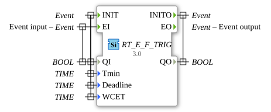

# RT_E_F_TRIG

* * * * * * * * * *

## Introduction

Real-time version of the E_F_TRIG block (Falling Edge).

## Interface

| Port     | Type  | Description                                     |
| :------- | :---- | :---------------------------------------------- |
| INIT     | Event | Initialization (with QI, Tmin, Deadline, WCET)  |
| EI       | Event | Event input (with QI)                           |
| INITO    | Event | Initialization done (with QO)                   |
| EO       | Event | Event output                                    |
| QI       | BOOL  | Input signal                                    |
| Tmin     | TIME  | Real-time parameter (with INIT)                 |
| Deadline | TIME  | Real-time parameter (with INIT)                 |
| WCET     | TIME  | Real-time parameter (with INIT)                 |
| QO       | BOOL  | Output signal (with INITO)                      |

## Metadata

| Attribute     | Value                            |
| :------------ | :------------------------------- |
| License       | EPL-2.0                          |
| Version       | 3.0 (2025-04-14, Patrick Aigner) |
| 4diac Package | eclipse4diac::rtevents           |

---

### 🌐 Related topic subpages on ms-muc-docs.de

- [🌐 Eclipse 4diac IDE & Color Reference on ms-muc-docs.de](https://www.ms-muc-docs.de/iec-61499/eclipse-4diac/)
