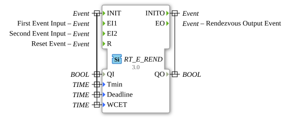

# RT_E_REND

* * * * * * * * * *

## Introduction

Real-time version of the E_REND block (Rendezvous). Waits for two events.

## Interface

| Port     | Type  | Description                                     |
| :------- | :---- | :---------------------------------------------- |
| INIT     | Event | Initialization (with QI, Tmin, Deadline, WCET)  |
| EI1      | Event | First event input                               |
| EI2      | Event | Second event input                              |
| R        | Event | Reset event                                     |
| INITO    | Event | Initialization done (with QO)                   |
| EO       | Event | Rendezvous output event                         |
| QI       | BOOL  | Input (with INIT)                               |
| Tmin     | TIME  | Real-time parameter (with INIT)                 |
| Deadline | TIME  | Real-time parameter (with INIT)                 |
| WCET     | TIME  | Real-time parameter (with INIT)                 |
| QO       | BOOL  | Output (with INITO)                             |

## Metadata

| Attribute     | Value                            |
| :------------ | :------------------------------- |
| License       | EPL-2.0                          |
| Version       | 3.0 (2025-04-14, Patrick Aigner) |
| 4diac Package | eclipse4diac::rtevents           |

--

### 🌐 Related topic subpages on ms-muc-docs.de

- [🌐 Eclipse 4diac IDE & Color Reference on ms-muc-docs.de](https://www.ms-muc-docs.de/iec-61499/eclipse-4diac/)

]
