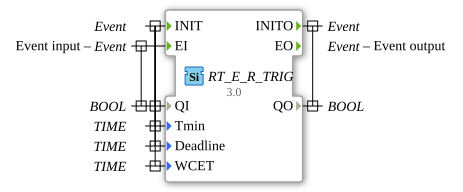

# RT_E_R_TRIG

* * * * * * * * * *

## Introduction

Real-time variant of the E_R_TRIG function block (rising edge).

## Interface

### Event inputs

| Event | Associated variables | Description |
| :---- | :------------------- | :---------- |
| INIT | QI, Tmin, Deadline, WCET | Initialization |
| EI | QI | Event input |

### Event outputs

| Event | Associated variables | Description |
| :---- | :------------------- | :---------- |
| INITO | QO | Confirmation of the initialization |
| EO | - | Event output |

### Input variables

| Name | Type | Description |
| :--- | :--- | :---------- |
| QI | BOOL | Input (with INIT: initialization; with EI: value to be evaluated) |
| Tmin | TIME | Timing parameter of the real-time variant (not further commented in the source) |
| Deadline | TIME | Timing parameter of the real-time variant (not further commented in the source) |
| WCET | TIME | Timing parameter of the real-time variant (not further commented in the source) |

### Output variables

| Name | Type | Description |
| :--- | :--- | :---------- |
| QO | BOOL | Initialization output (with INITO) |

## Metadata

| Attribute     | Value                            |
| :------------ | :------------------------------- |
| License       | EPL-2.0                          |
| Version       | 3.0 (2025-04-14, Patrick Aigner) |
| 4diac package | eclipse4diac::rtevents           |

---

### 🌐 Related topic subpages on ms-muc-docs.de

- [🌐 Eclipse 4diac IDE & color reference on ms-muc-docs.de](https://www.ms-muc-docs.de/iec-61499/eclipse-4diac/)
