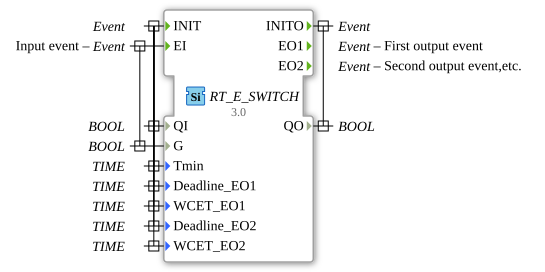

# RT_E_SWITCH

* * * * * * * * * *

## Introduction

Real-time version of the E_SWITCH block. Routes the input event EI to one of the two outputs EO1/EO2 depending on G.

## Interface

### Event inputs

| Event | Associated variables | Description |
| :---- | :------------------- | :---------- |
| INIT | QI, Tmin, Deadline_EO1, WCET_EO1, Deadline_EO2, WCET_EO2 | Initialization |
| EI | G | Input event |

### Event outputs

| Event | Associated variables | Description |
| :---- | :------------------- | :---------- |
| INITO | QO | Confirmation of the initialization |
| EO1 | - | First output event |
| EO2 | - | Second output event |

### Input variables

| Name | Type | Description |
| :--- | :--- | :---------- |
| QI | BOOL | Initialization input |
| G | BOOL | Switching condition, associated with EI |
| Tmin | TIME | Timing parameter of the real-time variant (not further commented in the source) |
| Deadline_EO1, Deadline_EO2 | TIME | Timing parameter of the real-time variant (not further commented in the source), per output |
| WCET_EO1, WCET_EO2 | TIME | Timing parameter of the real-time variant (not further commented in the source), per output |

### Output variables

| Name | Type | Description |
| :--- | :--- | :---------- |
| QO | BOOL | Initialization output (with INITO) |

## Metadata

| Attribute     | Value                            |
| :------------ | :------------------------------- |
| License       | EPL-2.0                          |
| Version       | 3.0 (2025-04-14, Patrick Aigner) |
| 4diac Package | eclipse4diac::rtevents           |

--

### 🌐 Related topic subpages on ms-muc-docs.de

- [🌐 Eclipse 4diac IDE & Color Reference on ms-muc-docs.de](https://www.ms-muc-docs.de/iec-61499/eclipse-4diac/)
