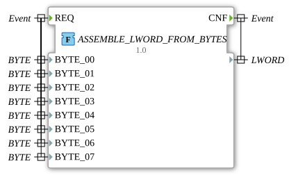

# ASSEMBLE_LWORD_FROM_BYTES

* * * * * * * * * *

## Introduction

The function `ASSEMBLE_LWORD_FROM_BYTES` combines eight BYTE values into a single LWORD value. It is useful when data from several byte sources (e.g. protocol fields) has to be assembled into a 64-bit unit.

## Interface Structure

### **Event Inputs**

- **REQ**: Initiates the combination of the BYTE values into an LWORD. Linked to `BYTE_00` to `BYTE_07`.

### **Event Outputs**

- **CNF**: Signals the completed combination. The LWORD value is available at the data output.

### **Data Inputs**

- **BYTE_00**: Least significant byte (B0) of the LWORD.
- **BYTE_01**: Byte B1.
- **BYTE_02**: Byte B2.
- **BYTE_03**: Byte B3.
- **BYTE_04**: Byte B4.
- **BYTE_05**: Byte B5.
- **BYTE_06**: Byte B6.
- **BYTE_07**: Most significant byte (B7) of the LWORD.

### **Data Outputs**

- **(unnamed)**: The assembled LWORD value (return value of the function).

### **Adapters**

No adapters available.

## Functionality

The function assigns each input byte directly to the corresponding byte of the return value:

- `BYTE_00` → `%B0` (least significant)
- `BYTE_01` → `%B1`
- `BYTE_02` → `%B2`
- `BYTE_03` → `%B3`
- `BYTE_04` → `%B4`
- `BYTE_05` → `%B5`
- `BYTE_06` → `%B6`
- `BYTE_07` → `%B7` (most significant)

## Technical Details

- Implemented as a function (`FUNCTION ... : LWORD`) in ST (Structured Text), package `eclipse4diac::utils::assembling`.
- Individual bytes are accessed with the partial access syntax `%B0` to `%B7`.
- No state of its own.

## Application Scenarios

- Assembling 64-bit values from individual bytes, e.g. in protocol implementations or CAN data.

## ⚖️ Comparison with Similar Building Blocks

- [ASSEMBLE_DWORD_FROM_BYTES](./ASSEMBLE_DWORD_FROM_BYTES.md) assembles four bytes into a DWORD, [ASSEMBLE_LWORD_FROM_WORDS](./ASSEMBLE_LWORD_FROM_WORDS.md) four words into an LWORD.

## Conclusion

`ASSEMBLE_LWORD_FROM_BYTES` assembles eight BYTE values byte by byte into an LWORD.
