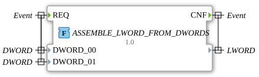

# ASSEMBLE_LWORD_FROM_DWORDS



* * * * * * * * * *

## Introduction

The function `ASSEMBLE_LWORD_FROM_DWORDS` combines two 32-bit double words (`DWORD`) into one 64-bit long word (`LWORD`).

## Interface Structure

### **Event Inputs**

- `REQ`: Starts the processing. Associated data: `DWORD_00`, `DWORD_01`

### **Event Outputs**

- `CNF`: Signals the processing and the output of the combined `LWORD`.

### **Data Inputs**

- `DWORD_00`: Double word 0 (`DWORD`), lowest 32 bits of the result
- `DWORD_01`: Double word 1 (`DWORD`), highest 32 bits (bits 32 to 63)

### **Data Outputs**

- (no name): The combined 64-bit long word (`LWORD`), also the return value of the function

### **Adapters**

This function does not use any adapters.

## How it works

The function assigns the two input values to the return value via the partial access `.%D0` and `.%D1`:

```text
ASSEMBLE_LWORD_FROM_DWORDS.%D0 := DWORD_00;
ASSEMBLE_LWORD_FROM_DWORDS.%D1 := DWORD_01;
```

`DWORD_00` thus forms the least significant and `DWORD_01` the most significant double word of the `LWORD`.

## Technical Details

- Implemented in Structured Text (ST) as a `FUNCTION` without internal state
- Part of the package `eclipse4diac::utils::assembling`
- The inverse function is [`SPLIT_LWORD_INTO_DWORDS`](../splitting/SPLIT_LWORD_INTO_DWORDS.md)
- Version 1.0 (2026-05-16)

## Application Scenarios

- Assembling a 64-bit value from two 32-bit registers (e.g. fieldbus data)
- Generating 64-bit bit patterns from two double words

## Summary

`ASSEMBLE_LWORD_FROM_DWORDS` assembles two `DWORD` values, starting with the least significant one, into an `LWORD`.
