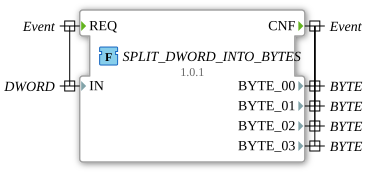

# SPLIT_DWORD_INTO_BYTES

* * * * * * * * * *

## Introduction

The function `SPLIT_DWORD_INTO_BYTES` splits a `DWORD` value into its four `BYTE` parts. It is the counterpart of [`ASSEMBLE_DWORD_FROM_BYTES`](../assembling/ASSEMBLE_DWORD_FROM_BYTES.md).

## Interface Structure

### **Event Inputs**

- **REQ**: starts the split. Associated data: `IN`.

### **Event Outputs**

- **CNF**: signals the completed split. Associated data: `BYTE_00` to `BYTE_03`.

### **Data Inputs**

- **IN** (`DWORD`): value to split

### **Data Outputs**

- **BYTE_00** (`BYTE`): least significant byte (`%B0`)
- **BYTE_01** (`BYTE`): byte `%B1`
- **BYTE_02** (`BYTE`): byte `%B2`
- **BYTE_03** (`BYTE`): most significant byte (`%B3`)

### **Adapters**

No adapters available.

## Functionality

The function assigns each output the corresponding byte of the input:

- `BYTE_00 := IN.%B0`
- `BYTE_01 := IN.%B1`
- `BYTE_02 := IN.%B2`
- `BYTE_03 := IN.%B3`

## Technical Details

- Implemented as an ST function (`FUNCTION`) with `VAR_OUTPUT`, package `eclipse4diac::utils::splitting`
- Individual bytes are accessed with the partial access syntax `%B0` to `%B3`
- No state of its own

## Application Scenarios

- Splitting 32-bit values into individual bytes, e.g. for protocols or CAN data

## ⚖️ Comparison with Similar Building Blocks

- [`SPLIT_WORD_INTO_BYTES`](./SPLIT_WORD_INTO_BYTES.md) splits a `WORD` into two bytes, [`SPLIT_DWORD_INTO_WORDS`](./SPLIT_DWORD_INTO_WORDS.md) a `DWORD` into two words.

## Conclusion

`SPLIT_DWORD_INTO_BYTES` splits a `DWORD` byte by byte into four `BYTE` outputs.
