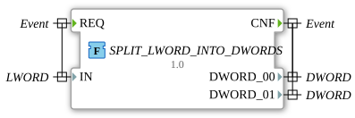

# SPLIT_LWORD_INTO_DWORDS



* * * * * * * * * *

## Introduction

The function `SPLIT_LWORD_INTO_DWORDS` extracts the two 32-bit double words (`DWORD`) from a 64-bit long word (`LWORD`).

## Interface Structure

### **Event Inputs**

- `REQ`: Starts the processing. Associated data: `IN`

### **Event Outputs**

- `CNF`: Signals the processing. Associated data: `DWORD_00`, `DWORD_01`

### **Data Inputs**

- `IN` (`LWORD`): Long word to be split

### **Data Outputs**

- `DWORD_00` (`DWORD`): Least significant double word (bits 0 to 31)
- `DWORD_01` (`DWORD`): Most significant double word (bits 32 to 63)

### **Adapters**

This function uses no adapters.

## How it works

The function assigns the parts via partial access:

```text
DWORD_00 := IN.%D0;
DWORD_01 := IN.%D1;
```

## Technical Details

- Implemented in Structured Text (ST) as a `FUNCTION` without internal state
- Part of the package `eclipse4diac::utils::splitting`
- The inverse is formed by the `ASSEMBLE_*` functions in the package `assembling` (e.g. [`ASSEMBLE_LWORD_FROM_WORDS`](../assembling/ASSEMBLE_LWORD_FROM_WORDS.md) for `WORD` parts).

## Application Scenarios

- Splitting a 64-bit value into two 32-bit values, e.g. for fieldbus or register access

## Summary

`SPLIT_LWORD_INTO_DWORDS` splits an `LWORD` into its least significant and its most significant `DWORD`.
